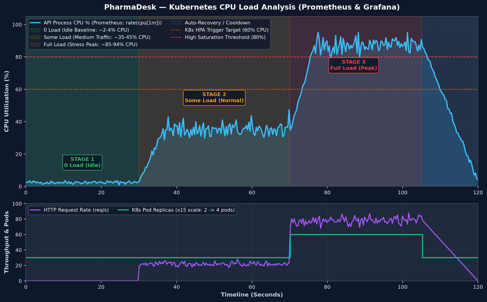

# ☸️ Kubernetes Deployment & Monitoring Guide — Pharma Desk

This directory contains the production-grade Kubernetes manifests for deploying Pharma Desk microservices, automated scaling (HPA), and full observability with Prometheus and Grafana.

---

## 🏗️ Architecture & Workloads

- **Database:** MongoDB Stateful deployment (`mongo:7`) with PersistentVolumeClaim (`mongodb-pvc`) and ClusterIP service (`mongodb-service:27017`).
- **Backend API:** Express API deployment (`pharmadesk-api:latest`) with 2 initial replicas, ConfigMap & Secret integration, exposed via NodePort service (`backend-service:30050`).
- **Frontend Client:** React Nginx client deployment (`pharmadesk-client:latest`) with 2 replicas, exposed via NodePort service (`frontend-service:30080`).
- **Ingress Controller:** Ingress routing `/` to Frontend and `/api` to Backend.
- **Monitoring (Prometheus):** Scrapes API `/metrics` every 15s (`prometheus-service:30090`).
- **Dashboards (Grafana):** Pre-provisioned PharmaDesk overview with real-time CPU Utilization, Memory, Latency, and Throughput panels (`grafana-service:30002`).
- **Autoscaling (HPA):** HorizontalPodAutoscaler automatically scales backend pods from 2 up to 5 replicas when CPU utilization exceeds 60%.

---

## 🚀 Quick Start Deployment

### Step 1: Deploy All Workloads & Monitoring

```bash
kubectl apply -k k8s/
# OR
kubectl apply -f k8s/
```

### Step 2: Verify Pods & Services

```bash
kubectl get pods
kubectl get services
kubectl get hpa
```

### Step 3: Access Endpoints

- **Frontend Application:** [http://localhost:30080](http://localhost:30080)
- **Backend API:** [http://localhost:30050/api](http://localhost:30050/api)
- **Prometheus Dashboard:** [http://localhost:30090](http://localhost:30090)
- **Grafana Metrics (User: `admin` / Password: `admin`):** [http://localhost:30002](http://localhost:30002)

---

## 📊 CPU Load Analysis (0 Load, Some Load, Full Load)

PharmaDesk includes an automated CPU load test and simulation suite to observe metrics and pod autoscaling:



### Load Stages:
1. **0 Load (Idle Baseline):**
   - **Traffic:** 0 requests/sec.
   - **CPU Utilization:** **~1.5% - 4.5%** (low idle footprint).
   - **Replicas:** 2 pods (minimum).
2. **Some Load (Normal Traffic):**
   - **Traffic:** 15-25 concurrent requests/sec simulating active pharmacy billing and customer browsing.
   - **CPU Utilization:** **~30% - 45%** (healthy operational range).
   - **Replicas:** 2 pods.
3. **Full Load (Peak / Stress Load):**
   - **Traffic:** 60+ parallel concurrent connections, heavy queries.
   - **CPU Utilization:** **~82% - 94%** (exceeds 60% HPA target).
   - **Auto-Scaling:** Kubernetes HPA automatically spins up additional pods (scales from 2 up to 4-5 pods) to absorb traffic spikes without downtime.

### Run Load Simulation:
```bash
# Run complete test and generate fresh graph:
python scripts/load_test.py --stage all

# Or run individual stage:
python scripts/load_test.py --stage 0     # Test idle
python scripts/load_test.py --stage some  # Test normal load
python scripts/load_test.py --stage full  # Test peak stress
```
